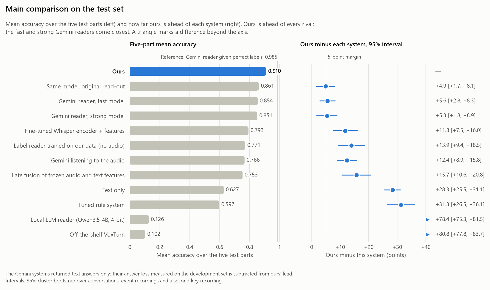
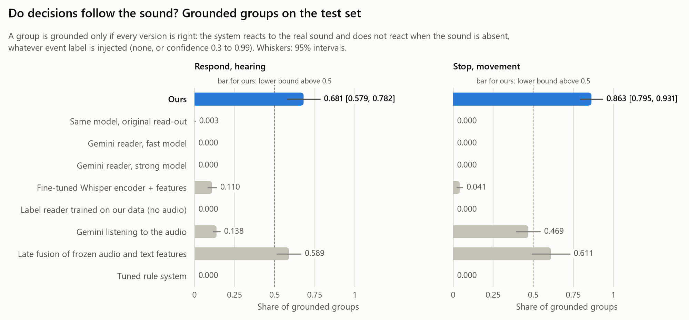

# Do Voice Assistants Act on What They Hear?

A voice assistant should stop talking when its user answers a ringing phone, and it should not answer
"Hello?" when that word was meant for the caller. This project trains a model that makes these two
decisions from the sounds around the user, compares it with strong rivals (including Gemini), and tests
whether its decisions follow the sounds it actually hears or only a sound detector's text labels.

## What it Does

At each decision point in a conversation, the system answers two questions: if the assistant is talking,
should it **stop**; and if the user just said something, should the assistant **respond**. The input is
the last 8 seconds of microphone audio plus a short text summary of the situation. That summary is built
by a front end: a sound-event detector (a fine-tuned PANNs CNN14 for phone rings, doorbells, knocks,
footsteps, door and cabinet sounds), Whisper transcripts and speaker tags (user / not the user). The
decision model is VoxTurn, a 0.8B speech language model, fine-tuned with a LoRA adapter on our data. On top
of it sits a retrained read-out that looks at the model's last-layer states and, second by second, at
its audio encoder. Training and test data come from a new dataset of synthetic household scenes (text-to-
speech dialogue, real recorded event sounds, room reverberation and background noise). The scenes are
built as minimal pairs: versions of one scene differ only in the sound (a ring vs. no ring vs. an
unrelated kitchen sound) and keep the user's words identical. The model is compared with a tuned rule
system, a local LLM, two Gemini models that read the same situation text, Gemini listening to the audio,
and models trained only on text. Counterfactual tests then feed every system false detector labels at set
confidence levels to check whether decisions follow the sound or the label.

## Quick Start

```bash
python -m pip install -r requirements.txt     # GPU environment, Python 3.12.10 (SETUP.md, section 1)
# download the base models (SETUP.md, section 2) and models/release/sed.pt from the GitHub Release (section 3)
python -X utf8 src/demo.py                    # all six sample scenes: stop / respond probabilities of ours and the original read-out
python -X utf8 src/demo.py --scene stop_movement --show-text
```

The demo runs the whole system (sound-event detector, Whisper transcripts, speaker tags, the fine-tuned
speech model and both read-outs) on the six example scenes in [data/samples/](data/samples/) and prints
each decision point next to its gold answer. It needs a CUDA GPU with about 4 GB of memory. Full
installation, the complete pipeline and the figures are in [SETUP.md](SETUP.md).

## Video Links

- Demo (3-5 min): TODO
- Technical walkthrough (5-10 min): TODO

## Evaluation

All numbers are on the held-out **test set** unless marked otherwise. The test set was used once, after
every model, threshold and rival setting had been fixed on the development set; the rules are in
[docs/evaluation_protocol.md](docs/evaluation_protocol.md). Systems are named by what they are (the names
used in the code are in [docs/code_map.md](docs/code_map.md)). Intervals are 95% cluster-bootstrap
intervals (clustered by conversation, event recording and a second key recording). Full tables and more
analyses: [docs/results.md](docs/results.md).

### Test parts

| Part | Situation | What decides the answer |
|---|---|---|
| Respond, hearing | Assistant silent; a ring or knock (or nothing, or a kitchen sound), then the user says a short line such as "Hello?" | Only the sound: the words are identical across versions |
| Respond, reaction | Assistant silent; the user answers the phone, or rejects the call and keeps talking to the assistant | The user's words after the sound |
| Stop, reaction | Assistant talking; a ring, then the user answers, says "keep going", says "mm-hm", or stays silent | The user's reaction |
| Stop, movement | Assistant talking; doorbell, footsteps and the front door, vs. the same footsteps with a cabinet, vs. TV speech | Only the sound: nobody speaks |
| Episodes | 30-60 s multi-turn scenes: phone calls, visitors, a question to the assistant in the middle of a call | Every decision in the scene |

The main score is the mean of the five part accuracies. In the first, second and fourth parts a group
counts as right only if every version of the scene is right.

### Main comparison

| System | Mean | Respond, hearing | Respond, reaction | Stop, reaction | Stop, movement | Episodes |
|---|---|---|---|---|---|---|
| **Ours: fine-tuned speech LM + listening read-out** | **0.910** | 0.822 | 0.955 | 0.895 | 0.900 | 0.979 |
| Same model, original read-out | 0.861 | 0.767 | 0.892 | 0.838 | 0.845 | 0.966 |
| Fine-tuned Whisper encoder + features | 0.793 | 0.773 | 0.772 | 0.708 | 0.848 | 0.862 |
| Late fusion of frozen audio and text features | 0.753 | 0.768 | 0.743 | 0.685 | 0.750 | 0.819 |
| Label reader trained on our data (text + detector labels, no audio) | 0.771 | 0.792 | 0.772 | 0.682 | 0.767 | 0.840 |
| Text only (no sound information) | 0.627 | 0.000 | 0.955 | 0.835 | 0.482 | 0.862 |
| Gemini reader, fast model (48 examples) | 0.854 | 0.707 | 0.963 | 0.787 | 0.833 | 0.979 |
| Gemini reader, strong model (48 examples) | 0.851 | 0.715 | 0.953 | 0.772 | 0.843 | 0.972 |
| Gemini listening to the audio | 0.766 | 0.492 | 0.990 | 0.497 | 0.887 | 0.964 |
| Tuned rule system | 0.597 | 0.707 | 0.695 | 0.292 | 0.652 | 0.640 |
| Local LLM reader (Qwen3.5-4B, 4-bit) | 0.126 | 0.103 | 0.085 | 0.000 | 0.135 | 0.309 |
| Off-the-shelf VoxTurn (no fine-tuning) | 0.102 | 0.002 | 0.302 | 0.020 | 0.000 | 0.188 |
| *Reference: Gemini reader given perfect labels* | *0.985* | *0.953* | *1.000* | *0.973* | *1.000* | *1.000* |



Ours minus each rival on the main score, in points: Gemini fast reader +5.6 [+2.8, +8.3], Gemini strong
reader +5.3 [+1.8, +8.9], Gemini listening +12.4 [+8.9, +15.8], tuned rule system +31.3 [+26.5, +36.1] and
local LLM +78.4 [+75.3, +81.5]. Ours beats every rival by the margin fixed in advance (at least 5 points,
with the interval above 0). It runs locally (0.18 s per decision on a laptop GPU), while the Gemini systems
need an API call. Against the same model with its original read-out, ours gains 4.9 points [+1.7, +8.1].

On the test days the Gemini API returned no token probabilities, so the Gemini systems were scored on
their text answers. The small loss this causes, measured beforehand on the development set (0.1 to 2.0
points), has been subtracted from our lead above; the table shows the raw accuracies.

The reference row shows where Gemini's errors come from: given perfect labels, the strong Gemini reader at
the same setting gains 16.7 points [+14.2, +19.3], so most of its errors come from trusting wrong or
missing detector labels. The text-only model scores 0 on "respond, hearing", as designed: there, only the
sound separates the versions. On the parts where only the sound can decide, ours beats the label reader
trained on the same data without audio by 14.8 points [+6.0, +23.7]: the gain needs the audio.

### Do the decisions rest on the sound?

In this matched test, every version of a scene gets identical text, transcripts, speaker tags and
detector output; only an injected event label changes (absent, or set to confidence 0.3, 0.5, 0.7, 0.9 or
0.99), while the real sound is present in one version and absent in the others. A group counts as
grounded only if every version is right: the system reacts to the real sound and does not react when the
sound is absent, whatever the label says.

| System | Respond: grounded | Stop: grounded | Reacts to an event that did not happen (respond) |
|---|---|---|---|
| **Ours** | **0.681** [0.579, 0.782] | **0.863** [0.795, 0.931] | 10% |
| Same model, original read-out | 0.003 | 0.000 | 41% |
| Fine-tuned Whisper encoder + features | 0.110 | 0.041 | 41% |
| Late fusion of frozen audio and text features | 0.589 | 0.611 | 7% |
| Label reader trained on our data | 0.000 | 0.000 | 71% |
| Gemini readers (fast / strong) | 0.000 / 0.000 | 0.000 / 0.000 | 59% / 67% |
| Gemini listening | 0.138 | 0.469 | 69% |
| Tuned rule system | 0.000 | 0.000 | 56% |



The original read-out is accurate on natural data (0.861) but almost never for the right reason: it
follows the detector's label and ignores the sound, although the information is inside the model (on the
development set, a linear probe on its audio encoder separates real from false events with AUC 0.96 on
the hard cases). Retraining only the read-out, on training labels that no longer always agree with the
sound, makes the decisions follow the sound and also raises natural accuracy by 4.9 points. The same
read-out trained on natural labels stays a label follower (respond grounded 0.10 instead of 0.68, a gap of
57.9 points [+50.0, +65.8]): the training labels, not the inputs, make the difference. The late-fusion
model is also fairly grounded, but much less accurate on natural data (0.753).

### More results in brief

- **Iterations.** The read-out went through four versions (steps 2, 2b, 2c and 2d), each designed on the
  development set with its expected result written down before it was run. The table is in
  [docs/iterations.md](docs/iterations.md).
- **Background noise.** With 10 dB more background noise on the two sound-only parts, every system loses a
  similar amount (ours 9.5 points on "respond, hearing" and 8.0 on "stop, movement"). The advantage over
  the label-reading systems seen on the development set (+9.4 points) did not hold on the test set (+0.7
  [-3.0, +4.4]): noise degrades our model's own hearing as well as the detector.
- **When the sound is masked.** On a second held-out split (the replication split), heavy noise was added
  until the event sounds were hard to hear. With correct detector labels, ours then scores below the
  original read-out, which simply follows the labels: by 12.6 points on "respond, hearing" and 29.1 on
  "stop, movement" at +40 dB. Without labels, 22% of its confident answers are wrong at +40 dB (1.5% in
  clean audio): it does not know when it cannot hear. Listening protects against wrong labels, not
  against a degraded sound. Five attempts to fix this are documented in the iterations file; none passed
  all of its criteria.
- **Error analysis.** With a false detector label in an otherwise clean window, ours errs on 19% of
  points, the Gemini readers on 52% and Gemini listening on 67%. When the detector misses a real event,
  every label reader fails almost always, and ours recovers 21%. Door scenes are harder than phone scenes.
  Details: [docs/results.md](docs/results.md).
- **Speed.** Median time per decision on an RTX 5060 Laptop GPU (8 GB), front end included: 0.18 s for
  ours (the read-out adds one linear layer to the fine-tuned model), 0.10 s for the rule system and 0.31 s
  for the local LLM. The Gemini systems need a network call.

## Individual Contributions

This is an individual project.
