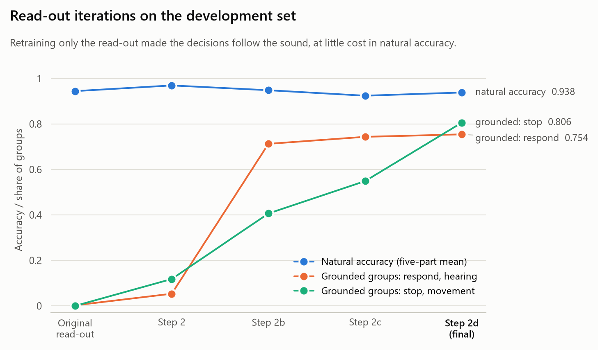

# Iterations

This document records how the task, the data, the evaluation and the decision model changed during
development, and which measurement led to each change. Every development decision was made on the
development set. The test set was opened once, from 2026-11-21 to 2026-11-23, after all systems, thresholds
and criteria had been frozen. The rules behind the numbers (the five test parts, group scoring, floor checks,
intervals and the decision table) are in the evaluation protocol (docs/evaluation_protocol.md). Systems are
named as in the README. Human decisions are attributed to the author; the code was written by Claude Code
(see ATTRIBUTION.md).

Terms used below:

- **Natural mean**: the unweighted mean of the five part scores ("respond, hearing", "respond, reaction",
  "stop, reaction", "stop, movement": group accuracy; "episodes": whole-episode accuracy) on the unmodified
  scenes, each system at its operating point chosen on the development set.
- **Grounded** (matched test): all versions of a scene get the same transcripts, speaker tags and detector
  output; only an injected detector label changes, while the real sound differs between the versions. A group
  counts as grounded when every version is right. *Respond grounded* is the mean over six label conditions on
  the "respond, hearing" groups (no event label, or one at confidence 0.3, 0.5, 0.7, 0.9 or 0.99). *Stop
  grounded* is the mean over four conditions on the "stop, movement" groups without visitor speech (no movement
  label, or false footsteps and door labels at 0.5, 0.9 or 0.99 in every version). A system that only reads
  labels scores 0 by construction.
- **Floor checks**: simple cases, such as a finished question to the assistant, that every system must get
  right at least 90% of the time at its operating point.
- **Must-listen part**: the groups in which only the sound separates the versions.

## Model iterations

The decision model is VoxTurn fine-tuned with a LoRA adapter. The iterations below replace only its last step,
the read-out that turns the model's internal states into stop and respond scores; the fine-tuned model stays
frozen. Before each of steps 2 to 2d was run, its design, its expected result and the rule for making it the
main system were written down. All numbers in this table are on the development set.

| Version (date) | What was tried | What the development set showed | What was changed next | Natural mean | Respond grounded | Stop grounded |
|---|---|---|---|---|---|---|
| Original read-out (2026-11-16) | VoxTurn's own answer head, fine-tuned with the LoRA adapter on natural training labels | Best local system on natural data. But it acts on a ring or knock label only above about 0.9 confidence and otherwise ignores the event, real or not. On the hard cases (labels of confidence 0.5-0.9) a linear probe on its audio encoder separates real from false events with AUC 0.96; its own decision does so with AUC 0.53 | Keep the model frozen and train a new linear read-out on its last-layer states plus a summary of its audio encoder, with ring and knock labels made independent of the truth in half of the training windows | 0.944 | 0.003 | 0.000 |
| Step 2 (2026-11-19) | Logistic-regression read-out on the last-layer states at the two answer positions plus the mean and max of the 104 audio-encoder tokens (4,096 inputs) | Follows the sound on the hard cases (23 of 24 real and 2 of 51 false labels followed). In the matched test it takes the unrelated kitchen sound for a ring once that sound's own label is gone, and it notices the user leaving only through the footsteps and door labels. A control read-out trained the same way on natural labels is grounded in no group | Make every detector class (kitchen sounds, footsteps, door, cabinet) independent of the truth, each with its own coin flip | 0.969 | 0.053 | 0.118 |
| Step 2b (2026-11-19) | The same read-out, trained with all label families decorrelated | Respond decisions now follow the sound, including ring versus kitchen sound. Stop decisions much less: every false label had the respond-scene timing (ending 0.3-1.5 s before the line), while a real door label is still on at the stop decision in 97% of cases, so in training a door label that ran up to the decision was always real | Copy each false label from a real label at the same kind of decision point (count, duration, class and timing) | 0.948 | 0.713 | 0.406 |
| Step 2c (2026-11-20) | Timing-matched false labels, same read-out | Respond kept; stop better but under its target (0.55), and natural accuracy under its bar (missed departures, false stops), so step 2b stayed the main system. Probes found the stop scenes' information in the audio encoder second by second (0.82 of stop groups right) but not in its 8-second mean and max (0.58) | Give the read-out the encoder's mean and max for each of the 8 seconds (18,432 inputs), trained on the step 2c data | 0.924 | 0.743 | 0.549 |
| **Step 2d, final** (2026-11-20) | Last-layer states plus the per-second encoder summary | All four replacement rules held: respond and stop grounding, natural accuracy with every floor check met, and stop grounding with the decision moved to 0.5, 1.5 and 2.0 s after the door opens. Main cost: false stops after short backchannels (9 of 150, against 1 for step 2b) | Became the main system; frozen on 2026-11-21 and run once on the test set | **0.938** | **0.754** | **0.806** |

The grounded columns come from the final version of the matched test (frozen on 2026-11-21), which scored all
five versions on the same inputs. When steps 2 to 2d were decided, the stop measure still used earlier
conditions with ring-class labels only; there the stop values were 0.009, 0.356, 0.542 and 0.780 for steps 2,
2b, 2c and 2d, in the same order. Step 2 was a candidate only: the main system went from the original read-out
to step 2b (chosen by the author on 2026-11-20) and then to step 2d.

From the original read-out to step 2d, respond grounding rose from 0.003 to 0.754 and stop grounding from
0.000 to 0.806, for 0.6 points of natural accuracy (0.944 to 0.938). The test set, scored once with every
version at its frozen development-set thresholds, shows the same order in grounding, and there the final
read-out also has the highest natural mean:

| Version | Natural mean (test) | Respond grounded (test) | Stop grounded (test) |
|---|---|---|---|
| Original read-out | 0.861 | 0.003 | 0.000 |
| Step 2 | 0.888 | 0.044 | 0.137 |
| Step 2b | 0.890 | 0.616 | 0.374 |
| Step 2c | 0.873 | 0.643 | 0.545 |
| **Step 2d, final** | **0.910** | **0.681** | **0.863** |

On the test set the final read-out was also more accurate on natural data than the original read-out (+4.9
points [+1.7, +8.1]). Against the two Gemini readers, the decision table fixed in advance records a tie for the
original read-out (+0.7 and +0.5 points) and a clear win for the final read-out (+5.6 and +5.3 points; see
2026-11-21 to 2026-11-23 below).

### Why each step followed from the previous measurement

- **Original read-out to step 2.** In the first false-label test (2026-11-16) the original read-out barely
  moved (-1.6 points), which looked like listening. The trust curves showed why: it ignored every ring or knock
  label below about 0.9 confidence, real ones included (1 of 24 real mid-confidence labels followed). A probe
  then showed that the sound is inside the model (encoder probe AUC 0.96) while the decision does not use it
  (0.53). The problem was the read-out, not the hearing, so only the read-out was retrained.
- **Step 2 to step 2b.** Training labels that always agree with the sound teach label-following: the control
  read-out trained on natural labels was grounded in no group. Step 2 decorrelated only the ring, doorbell and
  knock labels. It then used the sound to tell "ring" from "nothing", but not "ring" from "kitchen sound" (with
  no labels it treated 91% of the kitchen-sound versions as a ring) or "user left" from "user stayed", because
  the kitchen-sound, footsteps and door labels still always agreed with the truth. Step 2b decorrelated every
  class.
- **Step 2b to step 2c.** The false labels differed from the real ones in timing, a cue that only mattered on
  the stop side, where real door labels last up to the decision. Copying the timing of real labels removed the
  cue: the stop decisions then separated from the natural-label control (+0.18 at the decision level, against
  +0.03 for step 2b).
- **Step 2c to step 2d.** Within a group the leaving version was ranked first in about 99% of pairs, but it
  crossed the fixed threshold in only about half of the groups. Probes on the audio encoder showed that the
  stop information depends on when the sounds happen within the window (bell, steps, door): per second 0.82,
  pooled over 8 s 0.58, with the seconds shuffled 0.64. A read-out that sees each second separately recovered
  it; on the test set this gain held only at the designed decision time (see the failed decision-time
  criterion under 2026-11-21 to 2026-11-23).

## Dated log

### 2026-11-13 to 2026-11-14: the first task design (v0.3), one decision

- **Task.** One decision: after a household sound and a short user line such as "Hello?", should the assistant
  respond, or was the line meant for a caller or visitor? Each scene came as a triplet with identical words: a
  ring, doorbell or knock (do not respond), no sound (respond) or an unrelated kitchen sound (respond). Main
  score: the share of triplets with all three versions right.
- **Data.** Event sounds from FSD50K (single-source CC0 and CC BY clips, split by uploader and by audio
  fingerprint; 88 clips that also occur in MUSAN, VoxTurn's training noise, removed), lines generated by GPT-6.1
  and checked in both directions by Claude Opus 5.5 (12 phone lines and 5 door lines passed), Kokoro voices,
  simulated rooms and DEMAND noise, all split by source. A classifier on generator metadata could not tell the
  versions apart (AUC 0.52-0.53), and a leak check passed on all 14,077 planned items.
- **Models.** VoxTurn (frozen) with a new LoRA adapter and option head for this question (src/l1_voxturn.py),
  late fusion, a fine-tuned Whisper-base model, a tuned rule system (an event in the last few seconds, a short
  line, detector confidence above a threshold; 1,728 settings) and a local LLM reader.
- **Development checkpoint (2026-11-14).** Triplet accuracy: late fusion 0.880, tuned rule system 0.865,
  VoxTurn + LoRA 0.845, Whisper model 0.830, local LLM 0.635. The best learned model led the rule system by only
  +1.5 points [-12.5, +12.1] (an interval later found to be too wide, see 2026-11-14 below), and the systems
  failed on the same items (missed knocks, kitchen clatter heard as a ring).
- **Why it was replaced.** The scenes were too easy for simple rules: once the sound was heard, a detector and a
  three-condition rule solved the main cells. The author also pointed out that in real life a ring does not fix
  whom the user talks to (a user may reject a call and keep talking to the assistant), and that a talking
  assistant must also decide whether to stop. v0.3 stopped at this checkpoint; its test set was never opened.

### 2026-11-14: two-decision redesign (v0.4) and data generation

- **New task.** At every decision point the model answers two questions: if the assistant is talking, stop or
  keep going; if the user just spoke, respond or not. Five test parts (see the README): four single-line parts
  built from minimal pairs, plus multi-turn episodes; main score: the natural mean.
- **Scenario review.** An independent AI review of the first scenario draft found that simple cues solved every
  part: speech presence ("stop if anyone speaks"), the detector plus the closed list of answer lines, or a rule
  over the line text. Changes: each decision got two contrasts (hearing: same words, different sounds; reaction:
  same sound, different reactions), multi-turn episodes with text-ambiguous lines, speaker tags for every
  system, two attribution controls (the label reader trained on our data, and text only), a stronger rule system
  mined from the training data, and Gemini listening to whole episodes.
- **Plan review and freeze.** An independent AI review of the full evaluation plan found three critical
  problems, all fixed before the plan was frozen that afternoon:
  - the interval method gave one random weight per conversation times one per recording group, which inflates
    the variance (a simulation on the saved v0.3 scores gave 2.81 times the true standard error); it was
    replaced by a combination of one-way cluster bootstraps (1.10 times), calibrated by simulation before use;
  - the respond question was asked only where the gold stop answer was "stop", so the question revealed the
    answer; both questions are now asked wherever they apply;
  - shared answer phrasings made the reaction parts easy; answer and "keep going" lines are now split by
    phrasing between training, development and test.

  Every rival is compared with ours one by one: a clear win needs a lead of at least 5 points with the 95%
  interval above 0 and a floor-check mean within 5 points of the rival's; a second step checks whether the lead
  also holds on the must-listen part.
- **Data generation.** New sound classes from FSD50K (indoor footsteps, doors, cupboards and drawers), door
  recordings uploaded to Freesound after June 2023 for the test and replication splits only, TV speech from
  VoxPopuli split by speaker, and ECAPA speaker tags. New lines were checked in both directions (phone answers
  335 of 335, door answers 196 of 200, "keep going" lines 235 of 236, backchannels 10 of 12 passed). 2,500
  multi-turn scripts were generated and every decision point checked (Claude Opus 5.5, later Claude Sonnet 5.5
  with the author's approval). The checkers called "keep talking while the user ignores a ring" unclear (0 of
  179 confirmed) because they did not know the household rule; the author chose to ask all stop questions again
  with the rule stated, and then to ask the ignored-event points again with wording that matches the audio
  (nobody reacts for a few seconds). All 255 then passed; 2,499 of 2,500 scripts were kept.
- **Renderer fixes before use.** The episode timeline did not keep the script order (a "keep going" line could
  land before the event, and a stop point could turn into a respond point), and the episode planner took
  recordings a script did not use and kept the recording uses of failed plans. Both were fixed and the first
  episode renders discarded unseen.

### 2026-11-15: renders checked and sealed; first local systems on the development set

- **Shortcut checks** (2026-11-14 and 11-15). A classifier on generator metadata alone, trained on training
  renders, had to stay at AUC 0.55 or less on the development set in every part. The check itself had a flaw (a
  missing value filled with the training median let the trees see which sounds a version contains), which was
  fixed. Two parts then failed it because of features that belong to the scenes rather than to the generator:
  whether the phone still rings at a stop decision (an answered phone stops ringing), and, in episodes, the
  pause before a line and whether the user stands at the door (lines to a caller follow listening pauses). The
  author chose to keep them as reported diagnostics, and reports that split every system's accuracy by these
  features were added before any system was scored. Every remaining gate passed (AUC 0.50-0.54).
- **Planner bugs.** Short counts in the first test render traced to two bugs: the planning functions all read
  the last value of a loop variable, so recording caps were computed for the wrong number of units, and a cap
  shared by several sub-sets was computed from each sub-set's own count. On the smaller replication pools the
  cap trim then did not converge, and door sounds were capped by source in the planner but pooled in the check.
  All were fixed; the affected folders were deleted unread and rendered again.
- **Other checks.** 9 TV speakers were excluded because they occur in the speaker-ID model's training data or
  could not be checked. The interval method was calibrated on the development structure (independent units:
  1.125 times the analytic error, required 0.9-1.25; clustered: 0.912 of the true spread, required 0.8-1.2). The
  leak check passed on all 15 render folders.
- **Seals.** Final sizes: development 1,444 units and 3,692 decision windows; training 12 render draws and
  85,698 windows; test 6,175 units and 16,302 windows; replication 6,177 units and 16,248 windows. Each split's
  seal is the sha256 of its sorted window hashes, written in the render log. Test and replication were sealed
  after automatic checks only (counts, hashes, levels, timing); from 2026-11-21 the loader recomputes the seal
  whenever a sealed split is opened (src/p1v4_data.py). Two small exposures during the checks were logged (a
  checker quoted one test line; one replication TV sentence was printed, and its speaker was excluded).
- **First local systems on the development set.**
  - Detector (PANNs CNN14, fully fine-tuned on seven classes): macro F1 0.876; door (0.744) and cabinet (0.817)
    are the weak pair. A planned "calling out" class was dropped because the training data has none.
  - Tuned rule system: in its first run of 414,720 settings no setting met every floor check, and it stopped
    after "Okay." when the user ignored a ring (right on 12.7% of those points). Three options were added in its
    favour (listening sounds and "keep going" never count as leaving; phrases mined from transcripts; speaker
    tags on or off): 2,488,320 settings, natural mean 0.690, lowest floor check 0.88.
  - Two VoxTurn references made identical decisions at all 3,692 points: VoxTurn had been given the situation
    text instead of its documented input, the line transcript. Fixed before any system used its answers.
  - Natural mean: fine-tuned Whisper encoder + features 0.922, late fusion of frozen audio and text features
    0.863, label reader trained on our data 0.861, text only 0.639. Text only scored 0.003 on the must-listen
    part, so the text does not leak the answer where only the sound decides.
  - Fine-tuning VoxTurn at micro-batch 4 asked for 16.35 GB on the 8 GB laptop GPU; Windows moved the excess to
    system memory without an error (26 s per step), and one memory check stalled unseen for 6.5 hours. Fix:
    micro-batch 1 with 8 accumulation steps, and a hard memory cap on every GPU job.
  - Local LLM reader, first run: 0.054 with 6 examples; 24 and 48 examples ran out of memory (see 2026-11-16).

### 2026-11-16: original read-out, the rivals, fixes before the freeze

- **Original read-out.** VoxTurn + LoRA trained for 2 epochs (about 9 hours on the laptop GPU): natural mean
  0.944 ("respond, hearing" 0.850, "stop, movement" 0.967, episodes 0.985), every floor check met: the best local
  system. It led the tuned rule system by +25.5 points [+19.6, +31.3], but on the must-listen part only by +4.8
  [-4.3, +13.9]: the rule reads the same detector labels.
- **Local LLM reader** (src/p1v4_b2.py). The 24- and 48-example prompts had run out of memory only because the
  prompt prefix was encoded in one pass (a 1.6 GB attention table); in pieces of 1,024 tokens they fit, with the
  same scores at 6 examples. With more examples the model wrote the label first ("R: NOT"), so its answer is now
  also read after the label. Best: 48 examples, 0.098 (0.106 after the finer threshold grid below). It answers
  "do not respond" when the user excuses themselves, so the respond floor checks force a threshold near zero.
- **Gemini readers and listener** (src/p1v4_api.py). The readers got the same prompt as the local LLM (the
  written decision rules, 6, 24 or 48 examples, the situation text with Whisper large-v3-turbo transcripts); the
  listener got the audio as well, with 0 or 6 audio examples. All were scored from token probabilities. Gemini
  thinks by default and it was unknown which mode helps it, so the thinking mode became a
  setting chosen on the development set: both the default and a thinking budget of 0 were run and the better
  kept (uncertain choices favour the rival). Development set: fast reader 0.847 (48 examples, thinking), strong
  reader 0.878 (48 examples, no thinking), Gemini listening 0.796 (6 audio examples), reference with perfect
  labels 0.995. More examples helped both readers. The readers' errors were trust in false labels: of 51
  no-event "respond, hearing" windows with a false ring, doorbell or knock label, the strong reader got 20
  right, the fast reader 11, Gemini listening 31 and ours 50 (after the grid change below).
- **Finer threshold grid** (src/p1v4_score.py; before the freeze, in the rivals' favour). Every Gemini rival's
  threshold had stopped at 0.005, the lowest non-zero grid step, because log-probability scores lie very close
  to 0 or 1. The grid became steps of 0.001 plus values down to 10^-12 near 0 and near 1 (1,183 candidates), the
  same for every system. The rivals rose (strong reader 0.878 to 0.891, Gemini listening 0.796 to 0.823); ours
  did not move. The lead over the strong reader fell from +6.6 to +5.3 points [+0.4, +10.2].
- **One noise recording.** An independent AI review found that this lead came from one background-noise
  recording (a living room): without its units it was +1.0 [-4.6, +6.7]. The detector's false phone labels
  clustered at fixed seconds of that recording. The author listened to 8 clips at those seconds and heard faint
  singing, no phone or doorbell, so the gold labels stand and the false labels are a real detector weakness.
- **Injection pilot** (src/p1v4_inject_pilot.py; local systems only). Every development decision point without
  a real ring, doorbell or knock got one false "phone" detection (confidence drawn from real false alarms,
  median 0.42); the audio was unchanged. Natural mean, clean to injected: ours (original read-out) 0.944 to
  0.928, fine-tuned Whisper encoder + features 0.923 to 0.895, late fusion 0.863 to 0.834, label reader 0.862 to
  0.713, tuned rule system 0.690 to 0.584. The listening systems held up; the label reader trained on the same
  data did not.
- **Final-run code.** The decision table was written as code and dry-run on the development set, and a final
  runner reproduced every local system's stored development outputs exactly. Test and replication open only
  when a freeze record exists and a final-run variable is set.

### 2026-11-19: why the decisions follow labels; steps 2 and 2b; the matched test

- **Trust curves** (src/p1v4_trust_curves.py; approved by the author; stored development outputs only). The
  original read-out acts on a ring or knock label only above about 0.9 confidence. Of the mid-confidence labels
  (0.5-0.9) it followed 1 of 24 real and 0 of 51 false ones: it resisted the injected labels by ignoring labels,
  not by listening. The fine-tuned Whisper model followed 21 of 24 real and 2 of 51 false ones (it checks the
  label against the audio); the Gemini readers followed most false ones (fast 45 of 51, strong 31, listening 31).
- **Combination pilot** (src/p1v4_combo_pilot.py; approved by the author; exploratory). An equal-weight average
  of the log-odds of the original read-out and the Whisper model scored 0.966, with a lead over the strong reader
  of +7.4 points [+5.1, +9.8] no longer carried by one noise recording. The author pointed out that the aim is
  one model that really hears the environment, rather than one that leans on the pretrained backbone and the
  detector's text; the rest of the day followed from that.
- **Fairness prompts for the Gemini readers** (approved by the author; in the rivals' favour). An independent AI
  review on 2026-11-16 had noted that only the Gemini listener's prompt said the situation text can be wrong.
  Two variants were run: a note that the front end makes errors, and the note plus a table of the detector's
  measured precision on the development set by class and confidence band. With the table the fast reader rose to
  0.907 and the strong reader to 0.902, and they followed fewer false labels (25 and 16 of 51) but also fewer
  real ones (20 and 16 of 24): they trusted labels less without telling which were real. The original read-out's
  lead fell to +3.7 [-1.3, +8.7] and +4.2 [+0.3, +8.1], under the 5-point bar.
- **Probe pilot** (src/p1v4_probe_pilot.py; approved by the author; verdict rule fixed in advance). Linear probes
  on the frozen model, trained on training points whose ring, doorbell and knock labels were made independent of
  the truth. On the hard subset (75 development points with labels of confidence 0.5-0.9): audio-encoder probe
  AUC 0.960 [0.904, 0.997], last-layer probe 0.927, the model's own decision 0.533, the label confidence alone
  0.614. Verdict by the rule: the model hears the ring or knock, and its read-out ignores it.
- **Step 2** (src/p1v4_readout.py; approved by the author). See the table. It met its three criteria (hard
  subset: 23 of 24 real and 2 of 51 false labels followed; natural mean 0.969, at least 0.934; a drop of only
  1.6 points with false labels at 0.9), but one floor check sat exactly at 0.90: when the user told the
  assistant they would be right back because the phone was ringing, it leaned on "a phone was heard" over the
  words. A routed version, which the author chose to try next (the original read-out where a hearing probe and
  the label agree, step 2 where they disagree), met three of its four criteria and missed the floor criterion
  by one case.
- **Matched grounding test** (designed, reviewed and built). Every version of a group gets the same non-audio
  inputs with one matched event label. The first draft matched only the ring classes; an independent AI review
  found that other labels, such as "a household sound" on the kitchen-sound version, still differed between
  versions and gave a label-only model a false sound effect. Now all classes are matched, and the label reader
  and the rule system score exactly 0, as they must.
- **Gemini probabilities withdrawn.** On the evening of 2026-11-19 the Gemini API began to refuse token
  probabilities for both Gemini models used here. The rivals' development settings had been chosen on
  probabilities; an answer-only fallback was set up the next day.
- **Grounding rehearsal on the development set.** Respond grounded: original read-out 0.003, step 2 0.053, late
  fusion (whose detector embedding carries the sound's identity) 0.662; step 2 stop grounded 0.009 (on the
  conditions of that time). A control read-out trained the same way on natural labels: 0.000. Whatever label
  always agrees with the truth in training becomes the shortcut.
- **Step 2b** (src/p1v4_readout_allclass.py; approved by the author). Every label family decorrelated with its
  own coin flip. Its three predictions, fixed before the run, held: the states-only variant ranked ring versus
  kitchen sound right in 0.925 of pairs (at least 0.70); stop grounded 0.356 (at least 0.30); natural mean 0.948
  (at least 0.934, every floor check at least 0.90). Respond grounded 0.713.

### 2026-11-20: steps 2c and 2d; noise pilot; final-run code

- **Main system and Gemini fallback.** The author chose the step 2b read-out as the main system: the only
  candidate whose respond grounding cleared the bar (lower bound above 0.5) without losing natural accuracy
  against the original read-out. On the development set it then tied with the Gemini readers (+4.1 and +4.6
  points, under the 5-point margin): step 2 had profited from the kitchen-sound, footsteps and door labels,
  which are mostly right on the development set. The author decided in advance that if Gemini probabilities
  were back on test day they would be used; otherwise every Gemini rival would run on its answers, with its
  answer setting chosen on the development set and its development-set loss from answer-only scoring
  subtracted in the comparison. Answer-only development scores: fast reader 0.906, strong reader 0.896, Gemini
  listening 0.803 (after a variant with the detector-precision table was added for it).
- **Control with fixed random starts.** The natural-label control's result depended on its random start,
  because natural labels separate the answers almost perfectly and leave the sound direction unconstrained. It
  is now reported as the mean over 8 fixed starts, which made the comparisons with it about 0.06 less
  favourable to ours.
- **Stop diagnosis.** The author asked why stop grounding (0.36) was so far below respond (0.71) when both
  decisions are trained the same way. Within a group the leaving version was ranked first in 98% of pairs, but
  without movement labels only 33-43% of groups crossed the threshold; a probe on the audio encoder alone got
  0.60 of the groups right, so the sound was there. The cause was label timing (see the table), and the author
  chose to fix it rather than only report it.
- **Step 2c** (src/p1v4_readout_2c.py). False labels copied from real labels at the same kind of point, checked
  before training (door label still on at the decision: 0.99 real and 0.99 false, against 0.97 and 0 in step
  2b). Predictions fixed before the run: stop grounded at least 0.55, got 0.542 (missed); respond at least 0.65,
  got 0.743 (held); natural mean at least 0.934, got 0.924 (missed). By the rule, step 2b stayed the main system
  and step 2c became a reported row.
- **Time-resolved encoder diagnostic** (src/p1v4_ears_time_diag.py; approved by the author; rule and expectation
  fixed in advance). Probes on the audio encoder with different pooling, share of stop groups right: whole 8 s
  0.583; primary pooling (last 1 s, the 2 s before, the first 5 s) 0.597, +0.014 and short of the +0.10 rule;
  each of the 8 seconds 0.819, +0.236 [+0.119, +0.353]. A control added after seeing the result, with the
  seconds shuffled, fell to 0.639: what matters is when the sounds happen, not the number of inputs. As fixed in
  advance, the secondary result went to the author with no automatic switch.
- **Step 2d** (src/p1v4_readout_2d.py). The author chose option B, a read-out that keeps time. Four rules were
  fixed before the run: respond grounded at least 0.65 with lower bound above 0.5 (got 0.756); stop grounded at
  least 0.70 (0.780); natural mean at least 0.934 with every floor check met (0.938); and a new check with the 72
  development stop groups re-rendered and the decision moved to 0.5, 1.5 and 2.0 s after the door opens
  (instead of 1.0 s), where step 2d had to beat step 2c by at least 0.10 on average (+0.171 [+0.091, +0.252];
  step 2d 0.64, 0.81, 0.76 and 0.60 at 0.5, 1.0, 1.5 and 2.0 s). All four held, so step 2d replaced step 2b. It
  was the fourth change of the read-out after looking at the development set, each with its rule written down
  first. On the development set it still tied with the Gemini readers (+3.1 and +3.6 points).
- **Noise pilot on the development set.** The two parts where only the sound decides were rendered again with
  the background noise 10 dB louder. Detector false alarms rose (doorbell 0.7% to 13.0%, kitchen sounds 4.5% to
  20.4%), and a label of confidence 0.9-0.99 was right 49% of the time instead of 75%. Ours lost 9.5 and 11.3
  points on the two parts, the four label readers (original read-out, rule system, both Gemini readers) 16.5 to
  24.7. Averaged over them, ours lost 9.4 points [+5.0, +13.7] less. This was registered as a test criterion:
  at least 5 points less, with the interval above 0.
- **Final-run code.** A test-lock bypass was found and closed: one loader opened test and replication whenever
  it was called with the final-run flag. (While the fix was being checked, one process loaded the test metadata
  rows before the edit applied; nothing was printed, saved or scored.) A freeze script hashes every file the
  final run reads. Rehearsing the noise analysis showed that running the front end again is not bit-identical:
  speaker embeddings and a few Whisper turbo transcripts depend on which speech cuts share a batch (4 of 1,728
  speaker tags flipped). The stored development front end therefore stays the reference, and the test-day
  front-end script (src/p1v4_test_front.py) refuses the development set.
- **Pre-test reviews.** Three independent AI reviews (design and statistics, final-run code, claims) read the
  documents, the code and the development results: ready after fixes. None found test leakage or a choice that
  favoured ours.

### 2026-11-21: review fixes and the freeze

- **Fixes written down before any new development run** (approved by the author): three new stop conditions
  with false footsteps and door labels (0.5, 0.9, 0.99) in every version; t-based intervals where few recording
  groups dominate; score ties counted as ties; a shuffled-seconds read-out as a control for step 2d;
  natural-label read-outs with pooled and per-second encoder input (8 seeds each); a measure of how much more
  often ours follows real than false labels, also compared with the label reader; and the development-set
  variance of the answer-only loss added to the Gemini intervals.
- **Final development values.** Respond grounded 0.754 [0.639, 0.869]; stop grounded 0.806 [0.507, 1.104] (a t
  interval with 4 degrees of freedom: few door recordings). The new stop conditions happened to favour ours on
  the development set (the old ones gave 0.782 [0.410, 1.154], which would have failed the lower-bound bar);
  this was recorded. One criterion already failed on the development set: ours did not separate real from false
  labels clearly better than the label reader (+0.238 [-0.133, +0.609]).
- **Freeze.** One more independent AI review of all the fixes (2 blocking items in the test-day order, 7 major
  items) and a short focused check requested by the author (2 regressions) were verified and fixed. The freeze at
  10:10 hashed 193 files: code, models, read-outs, every threshold and setting, and the documents. From then on a
  change needed a development-set rerun that reproduced the frozen outputs and a recorded amendment.

### 2026-11-21 to 2026-11-23: the single test run

- **Running.** Gemini still refused token probabilities, so every Gemini system ran on its answers at its
  answer-mode setting. Before any test question on each of the three days, each Gemini system passed a drift
  check (301 fixed development questions, 0.3-5.0% changed answers, all under their limits); a guard stopped API
  runs at midnight so that every day's questions followed that day's check. The test front end, all local
  systems, every Gemini run (19,227 questions per setting), the matched test, the noise analysis and the
  best-setting-on-test runs all finished before any metric was computed.
- **Problems.** The local LLM reader's built-in cache check (cached against freshly encoded prompt, limit 0.05 on
  the first 3 questions) stopped the run at 24 examples with 0.056. A development-set diagnostic showed that the
  two encodings, both valid (4-bit weights, bf16, different split points), differ by up to 0.093, so the limit
  passed or failed by chance. The author chose a limit of 0.15; the change was rerun on the development set with
  identical scores and recorded as an amendment to the freeze record; no score changed. One Gemini run stalled
  without writing for about 25 minutes and was resumed from its answered questions.
- **Completeness check** (no metric): every score file complete, no missing answers, none asked without a
  passed drift check that day. Then every metric was computed once (2026-11-23, 01:24 to 01:50).
- **Main comparison.** Natural mean: ours 0.910, Gemini reader, fast model 0.854, Gemini reader, strong model
  0.851, same model with the original read-out 0.861, Gemini listening 0.766, tuned rule system 0.597, local LLM
  reader 0.126; reference with perfect labels 0.985. Ours minus the fast reader +5.6 points [+2.8, +8.3], minus
  the strong reader +5.3 [+1.8, +8.9] (each after subtracting the rival's development-set loss from answer-only
  scoring, 0.1 and 0.6 points, as fixed in advance), minus Gemini listening +12.4 [+8.9, +15.8], minus the rule
  system +31.3, minus the local LLM +78.4. Every floor check and the condition on the test-only subsets (new
  phrasings, a second speech engine, new recordings, phone vibrations, episodes written from a second prompt)
  held, and on the must-listen part ours beat the label
  reader (+14.8 [+6.0, +23.7]) and every rival. The decision table fixed in advance therefore gave its clear-win
  outcome. With the original read-out in place of ours it would have given a tie (+0.7 [-1.5, +2.8] and +0.5
  [-2.9, +3.8]). With every rival at its best setting chosen on the test set itself (not confirmatory), ours
  still led all of them.
- **Grounding.** Respond grounded 0.681 [0.579, 0.782], stop grounded 0.863 [0.795, 0.931], both above the 0.5
  bar; within-group concordance against Gemini listening +0.239 [+0.201, +0.278]. The checks that training
  labels decide (natural-label controls and the decorrelation ladder) passed, and so did the per-second encoder
  input against pooled input (+0.318) and against shuffled seconds (+0.275) at the designed decision time.
- **Three registered criteria failed** (every bootstrap seed from 1 to 6 gives the same verdicts):
  1. *Decision time.* With the stop decision moved to 0.5, 1.5 and 2.0 s after the door opens, step 2d had to
     beat step 2c by at least 0.10 on average; the difference was +0.087 [+0.023, +0.151] (step 2d 0.73, 0.85,
     0.67 and 0.43 at 0.5, 1.0, 1.5 and 2.0 s; step 2c 0.50, 0.56, 0.55 and 0.52). The gain from per-second
     hearing holds at the designed decision time (1 s after the door opens) and fades at later decision times
     (at 2.0 s it is below step 2c); the read-out probably relies on the fixed layout of the generated stop
     scenes.
  2. *Noise.* With the background noise 10 dB louder, ours had to lose at least 5 points less than the label
     readers; the difference was +0.7 points [-3.0, +4.4] (development pilot: +9.4). Ours kept ignoring most false
     labels, but the noise also damaged its own hearing and transcripts. Listening protects against wrong
     labels, not against degraded sound; this led to the reliability analyses below.
  3. *Reliance.* Ours had to separate correct from false detector labels (follow real ones, ignore false ones)
     better than the label reader trained on our data; the difference was +0.142 [-0.024, +0.307], an interval
     that includes 0 (the criterion had already failed on the development set). Ours does separate them (+0.339
     [+0.171, +0.506]), but not clearly better than a text model trained on the same data: the user's words
     often reveal whether the event happened.
- **Development set to test set.** The natural mean fell 2.8 points for ours, 3.7 for Gemini listening and 4.5
  to 9.2 for the label readers; the detector's doorbell recall fell from 0.97 on the development set to 0.44 on
  the new test recordings.

### 2026-11-23: reliability analyses on the development set

- **What the noise does** (test noise outputs, descriptive). At +10 dB the detector's recall barely moved but
  its false alarms rose (footsteps 1.8% to 11.4%, knock 3.4% to 9.3%). Ours followed false labels at 0.15-0.17
  at every noise level, while the strong reader went from 0.28 to 0.40. As the noise rose, ours became less
  confident (confident share 0.90 to 0.85 on "respond, hearing"), but its confident-error rate still rose (4.0%
  to 5.7%); the label readers' confidence barely moved while their confident errors roughly doubled.
- **Labels against hearing** (development set; labels none, false or true, crossed with background noise up to
  40 dB louder; transcripts kept clean). An audio-encoder probe's accuracy fell from 0.900 to 0.575. With true
  labels and damaged hearing, ours fell 11.5 to 21.3 points below the original read-out on "respond, hearing"
  (+20 to +40 dB) and 12.5 to 22.2 on "stop, movement": it trusts its ears even when they fail, the mirror image
  of the original read-out, which trusts labels even when they are wrong. Without labels its confident-error
  rate rose from 3.8% to 30.6%: it does not know when it cannot hear.
- **Five versions of a reliability fix** (development set only; criteria fixed before each run; independent AI
  reviews of versions 3 to 5 before they ran). None passed all of its criteria:
  1. A read-out trained on mixed label regimes and noisy audio (+10 to +40 dB): it moved to trusting labels
     (with false labels and clean sound, respond grounding fell from 0.685 to 0.465) and still did not know when
     it could not hear; natural mean 0.962.
  2. Plus a clarity signal read from the audio encoder (a regression to the signal-to-noise ratio, error about
     3.7 dB; the author chose the encoder over a waveform estimate) with clarity-dependent weights: no fix; on
     respond it grew more confident as the noise rose. This exposed a flaw in the criteria: once hearing fails,
     a missing label and a wrong label look the same, so no system can meet them all without a signal about how
     reliable the label source is.
  3. Plus such a source: device notifications (phone, doorbell, a front-door sensor) with an explicit
     "notifications unavailable" state. The read-out barely used the notification line; the trust criteria
     failed, and natural accuracy stayed within 3 points (0.915 against 0.938).
  4. Explicit doubt (the author's choice): a small confidence model that follows the clarity, and notifications
     as structured inputs. Confident errors on respond without labels fell from 23.1% to 9.9% at +30 dB and from
     32.7% to 15.0% at +40 dB, and the front-door notification settled the stop side; but false labels stayed
     invisible, and at matched coverage the lower error came from fewer confident decisions, not better ones.
  5. Plus a label-dependence score (the score with labels minus the score without), a words-only score for
     respond, a smoother clarity basis and longer fold training. Notifications now settle respond (close to a
     rule), and ranking under false labels improved (AUROC 0.84 against 0.67) at a cost on true labels; three
     criteria still failed (notifications against confident false labels, confident errors at +40 dB, knock
     scenes without a notification).

### 2026-11-24: confirmation on the replication split and new noise types

- **Confirmation.** 59 claims from the reliability analyses (19 key ones) were written down with their reading
  rules, the replication split's new use was recorded in the freeze record, and the split was run once at +10
  to +40 dB with all seven label inputs. 18 of the 19 key claims were confirmed, also with Bonferroni-corrected
  intervals. The one not confirmed: the respond mirror at +20 dB, -4.3 points [-5.8, -2.9] against the 5-point
  bar (development set: -11.5). Respond effects were about half their development size, stop effects the same
  or larger; no claim was contradicted.
- **Sensitivity.** With the background-noise recording as a fifth clustering factor (reported only), the noise
  environment dominated the uncertainty, and 7 of the 19 key claims stayed clearly on the passing side. The
  respond mirror appears wherever the noise breaks the respond hearing (living room, river, restaurant) and not
  where it does not (office, field).
- **Mirror against hearing damage.** Over 28 cells per decision (7 noise types, 4 levels), the mirror grows
  almost one for one with the damage to hearing (slope -0.90 respond, -0.81 stop): true labels win back only
  about a fifth of what the ears lose.
- **New noise types** (not confirmatory). Appliance noise from another corpus (MS-SNSD: air conditioner, vacuum
  cleaner, washer/dryer, copy machine) on the replication units: the new cells fall on the same lines (slopes
  -0.92 and -0.88), and 18 of the 19 key claims hold. One is contradicted: with notifications at +40 dB, the
  fifth fix version's respond accuracy was 0.902 against a bar of 0.95. Side finding: the detector gives
  confident false labels on unfamiliar appliance noise (45 of 48 files have a frame of at least 0.5 for a target
  class), so confident false labels also occur naturally.

### 2026-11-24 to now: second backbone

- A second pretrained backbone, Voxtral Mini 3B, trained and evaluated with the same recipe: in progress.
