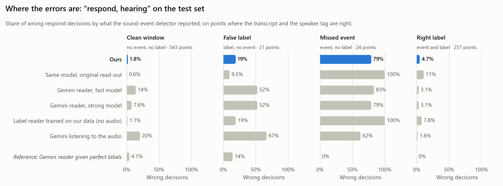
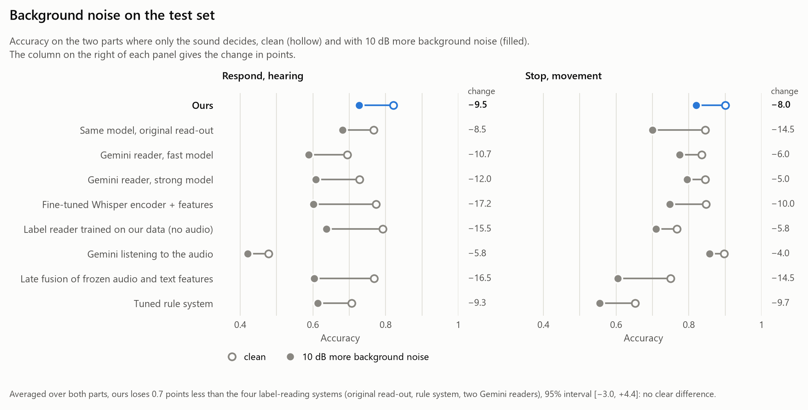
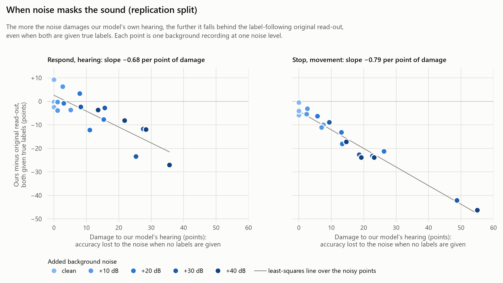

# Results in detail

This file holds the full tables behind the README's Evaluation section. Unless marked otherwise, numbers
are on the held-out test set, which was used once after all settings were fixed on the development set
(rules: [evaluation_protocol.md](evaluation_protocol.md)). Intervals are 95% cluster-bootstrap intervals
(clustered by conversation, event recording and a second key recording). The aggregate result files are in
[results/](../results/); the figures are made by [notebooks/figures.ipynb](../notebooks/figures.ipynb).

## 1. Main comparison

Five-part accuracy for every system, including two simple references.

| System | Mean | Respond, hearing | Respond, reaction | Stop, reaction | Stop, movement | Episodes |
|---|---|---|---|---|---|---|
| **Ours** | **0.910** | 0.822 | 0.955 | 0.895 | 0.900 | 0.979 |
| Same model, original read-out | 0.861 | 0.767 | 0.892 | 0.838 | 0.845 | 0.966 |
| Fine-tuned Whisper encoder + features | 0.793 | 0.773 | 0.772 | 0.708 | 0.848 | 0.862 |
| Late fusion of frozen audio and text features | 0.753 | 0.768 | 0.743 | 0.685 | 0.750 | 0.819 |
| Label reader trained on our data (no audio) | 0.771 | 0.792 | 0.772 | 0.682 | 0.767 | 0.840 |
| Text only | 0.627 | 0.000 | 0.955 | 0.835 | 0.482 | 0.862 |
| Text only, current line only | 0.529 | 0.000 | 0.978 | 0.870 | 0.000 | 0.800 |
| Gemini reader, fast model | 0.854 | 0.707 | 0.963 | 0.787 | 0.833 | 0.979 |
| Gemini reader, strong model | 0.851 | 0.715 | 0.953 | 0.772 | 0.843 | 0.972 |
| Gemini listening to the audio | 0.766 | 0.492 | 0.990 | 0.497 | 0.887 | 0.964 |
| Tuned rule system | 0.597 | 0.707 | 0.695 | 0.292 | 0.652 | 0.640 |
| Local LLM reader (Qwen3.5-4B, 4-bit) | 0.126 | 0.103 | 0.085 | 0.000 | 0.135 | 0.309 |
| Off-the-shelf VoxTurn | 0.102 | 0.002 | 0.302 | 0.020 | 0.000 | 0.188 |
| Reference: environment-blind gatekeeper (ignores sounds and history) | 0.109 | 0.002 | 0.340 | 0.018 | 0.000 | 0.186 |
| Reference: copy the previous decision | 0.067 | 0.000 | 0.000 | 0.000 | 0.000 | 0.333 |
| *Reference: Gemini reader given perfect labels* | *0.985* | *0.953* | *1.000* | *0.973* | *1.000* | *1.000* |

Ours minus each rival, in points. "Main score" is the five-part mean. "Sound-only parts" covers the groups
where only the sound can decide ("respond, hearing" and the silent "stop, movement" groups).

| Rival | Main score | Sound-only parts |
|---|---|---|
| Gemini reader, fast model | +5.6 [+2.8, +8.3] | +12.3 [+3.9, +20.6] |
| Gemini reader, strong model | +5.3 [+1.8, +8.9] | +12.1 [+2.0, +22.2] |
| Gemini listening to the audio | +12.4 [+8.9, +15.8] | +18.8 [+10.4, +27.2] |
| Tuned rule system | +31.3 [+26.5, +36.1] | +17.1 [+7.2, +26.9] |
| Local LLM reader | +78.4 [+75.3, +81.5] | +78.1 [+72.9, +83.4] |
| Label reader trained on our data (no audio) | +13.9 [+9.4, +18.5] | +14.8 [+6.0, +23.7] |
| Same model, original read-out | +4.9 [+1.7, +8.1] | |

- The Gemini systems were scored on their text answers, because the API returned no token probabilities
  on the test days. Their answer loss, measured on the development set (fast reader 0.1, strong reader
  0.6, listening 2.0 points), is subtracted from the differences above.
- Floor checks (simple control cases that every system must get right; listed in the evaluation
  protocol): ours scores at least 0.97 on each.
- Part of the test set was written with a scene-writing prompt never used for training data: ours scores
  0.876 there and stays ahead of the Gemini readers (+4.0 and +2.7 points).

## 2. Development set vs. test set

The test set uses event recordings that never occur in the training or development data (separate
recording groups, partly uploaded after June 2023), so all systems lose some accuracy. Ours loses the
least.

| System | Development | Test | Change |
|---|---|---|---|
| Ours | 0.938 | 0.910 | -2.8 |
| Same model, original read-out | 0.944 | 0.861 | -8.3 |
| Fine-tuned Whisper encoder + features | 0.923 | 0.793 | -13.0 |
| Label reader trained on our data | 0.862 | 0.771 | -9.1 |
| Gemini reader, fast model | 0.906 | 0.854 | -5.2 |
| Gemini reader, strong model | 0.896 | 0.851 | -4.5 |
| Gemini listening to the audio | 0.803 | 0.766 | -3.7 |
| Tuned rule system | 0.690 | 0.597 | -9.3 |

## 3. Do the decisions rest on the sound?

The README gives the grounded group accuracy. Here it is split by the injected label. "Right" is the
grounded group accuracy; "false reaction" is the share of versions without the sound where the system
still reacted as if the event had happened.

**Respond, hearing** (600 groups per condition):

| Injected label | Ours: right | Ours: false reaction | Original read-out: false reaction | Gemini strong reader: false reaction |
|---|---|---|---|---|
| none | 0.74 | 4% | 0% | 11% |
| confidence 0.3 | 0.70 | 4% | 14% | 30% |
| confidence 0.5 | 0.71 | 6% | 26% | 67% |
| confidence 0.7 | 0.70 | 7% | 33% | 95% |
| confidence 0.9 | 0.62 | 19% | 87% | 99% |
| confidence 0.99 | 0.61 | 21% | 88% | 100% |

**Stop, movement** (movement labels: footsteps and door):

| Injected label | Ours: right | Ours: false reaction | Original read-out: false reaction | Gemini strong reader: false reaction |
|---|---|---|---|---|
| none | 0.85 | 2% | 0% | 0% |
| confidence 0.5 | 0.86 | 2% | 0% | 0% |
| confidence 0.9 | 0.88 | 1% | 30% | 48% |
| confidence 0.99 | 0.86 | 1% | 31% | 87% |

The original read-out is never "right" here, even without a label: without a label in the text it gives
the majority answer and does not react to the real sound either. Ours still follows very confident false
ring labels in about one case in five; it does not follow false movement labels.

## 4. Error analysis

Natural "respond, hearing" points, split by what the front end got right (transcript right in all rows).
Each cell is the share of points the system got wrong.

| Front end on this point | Points | Ours | Original read-out | Label reader | Gemini fast | Gemini strong | Gemini listening |
|---|---|---|---|---|---|---|---|
| Speaker tag right, no label (clean) | 543 | 1.8% | 0.6% | 1.1% | 14.0% | 7.6% | 20.4% |
| Speaker tag right, false label | 21 | 19% | 9.5% | 19% | 52% | 52% | 67% |
| Speaker tag right, real event missed | 24 | 79% | 100% | 100% | 83% | 79% | 62.5% |
| Speaker tag right, right label | 257 | 4.7% | 10.9% | 7.8% | 3.1% | 3.1% | 1.6% |
| Speaker tag wrong, no label | 514 | 2.9% | 0.6% | 0.4% | 9.9% | 7.8% | 37.2% |
| Speaker tag wrong, false label | 30 | 43% | 27% | 37% | 73% | 77% | 77% |
| Speaker tag wrong, real event missed | 31 | 61% | 100% | 94% | 81% | 90% | 35% |
| Speaker tag wrong, right label | 242 | 4.1% | 11.2% | 7.9% | 2.5% | 1.7% | 0.8% |

What the table shows:
- Most errors of every system sit where the front end is wrong. The Gemini readers err far more than ours
  when a label is false, and Gemini listening is easily misled by a wrong speaker tag.
- When the detector misses a real event, the label readers have nothing to go on; ours, which hears the
  audio, recovers 21-39% of these points.
- In this natural sample the original read-out errs less than ours when a false label is present (two
  small rows, 21 and 30 points). The controlled test in section 3, where every false label has a fixed
  confidence, measures label-following directly.
- Door scenes are harder than phone scenes for ours: with no injected label, 0.65 of door groups are
  grounded against 0.84 of phone groups.
- The local LLM reader is strongly biased toward "do not respond" and does not follow the written rules
  even with 48 examples, so it fails nearly everything.

## 5. Background noise

The two sound-only parts were re-rendered with 5 and 10 dB more background noise, and every system was run
at its frozen setting. Accuracy, clean to noisy:

| System | Respond, hearing: +5 dB | +10 dB | Stop, movement: +5 dB | +10 dB |
|---|---|---|---|---|
| Ours | 0.822 to 0.792 | 0.727 (-9.5) | 0.900 to 0.875 | 0.820 (-8.0) |
| Same model, original read-out | 0.767 to 0.738 | 0.682 (-8.5) | 0.845 to 0.805 | 0.700 (-14.5) |
| Fine-tuned Whisper encoder + features | 0.773 to 0.713 | 0.602 (-17.2) | 0.848 to 0.825 | 0.748 (-10.0) |
| Late fusion of frozen audio and text features | 0.768 to 0.713 | 0.603 (-16.5) | 0.750 to 0.700 | 0.605 (-14.5) |
| Label reader trained on our data | 0.792 to 0.752 | 0.637 (-15.5) | 0.767 to 0.750 | 0.710 (-5.8) |
| Gemini reader, fast model | 0.695 to 0.667 | 0.588 (-10.7) | 0.835 to 0.815 | 0.775 (-6.0) |
| Gemini reader, strong model | 0.728 to 0.680 | 0.608 (-12.0) | 0.845 to 0.845 | 0.795 (-5.0) |
| Gemini listening to the audio | 0.478 to 0.462 | 0.420 (-5.8) | 0.897 to 0.873 | 0.858 (-4.0) |
| Tuned rule system | 0.707 to 0.690 | 0.613 (-9.3) | 0.652 to 0.600 | 0.555 (-9.7) |

(The Gemini systems' clean values differ slightly from section 1 because the clean questions were asked
again with the noisy ones.)

The test asked whether ours loses less than the label-reading systems (original read-out, rule system and
the two Gemini readers), averaged over both parts. On the development set it did, by 9.4 points [+5.0,
+13.7]; on the test set it did not: +0.7 [-3.0, +4.4]. The detector's false alarms rise with the noise
(for example knocks from 3.4% to 9.3% and footsteps from 1.8% to 11.4% at +10 dB), but our model's own
hearing degrades as well. Listening helps against wrong labels; it does not make the system robust to a
degraded sound.

## 6. When the sound is masked (replication split)

These checks were written down before a second held-out split, the replication split, was opened, and run
once. The background noise was raised by 10 to 40 dB until the event sounds were hard to hear; the
transcripts were kept clean so that only the sound was degraded.

Ours minus the original read-out when the detector labels are correct (accuracy, points):

| Part | +20 dB | +30 dB | +40 dB |
|---|---|---|---|
| Respond, hearing | -4.3 [-5.8, -2.9] | -9.9 [-11.8, -8.1] | -12.6 [-14.6, -10.5] |
| Stop, movement | -15.0 [-17.5, -12.6] | -25.4 [-28.6, -22.2] | -29.1 [-32.0, -26.2] |

The original read-out follows the labels, so correct labels keep it accurate whatever the noise. Ours
relies on its own hearing and loses accuracy as the sound is masked: the mirror image of the original
read-out's weakness. The figure shows the gap growing with the damage to our model's hearing, one point
per background recording and noise level.

Ours on "respond, hearing" without any detector label, by noise level:

| | Clean | +10 dB | +20 dB | +30 dB | +40 dB |
|---|---|---|---|---|---|
| Accuracy | 0.938 | 0.913 | 0.846 | 0.748 | 0.692 |
| Share of answers given with confidence >= 0.9 | 78% | 66% | 52% | 41% | 33% |
| Wrong among those confident answers | 1.5% | 1.8% | 5.1% | 14.1% | 22.1% |

The model becomes less confident as the noise grows, but not enough: at +40 dB, 22% of its confident
answers are wrong (22.0% on "stop, movement"; 52.8% on "respond, hearing" when a false label of confidence
0.99 is added). It does not know when it cannot hear. Of the 19 key checks written down in advance, 18
held; the miss was the respond gap at +20 dB (-4.3 against a bar of -5). Five attempts to make the model
weigh its hearing by how clear the sound is (a clarity signal from its own audio encoder, retraining under
noise, explicit device notifications) are described in [iterations.md](iterations.md); none passed all of
its criteria.

## 7. Speed

Median time per decision on an RTX 5060 Laptop GPU (8 GB), front end included:

| System | Median time per decision |
|---|---|
| Ours (and the same model with its original read-out) | 0.18 s |
| Late fusion of frozen audio and text features | 0.16 s |
| Fine-tuned Whisper encoder + features | 0.11 s |
| Tuned rule system | 0.10 s |
| Local LLM reader | 0.31 s |
| Gemini systems | network call |

Our read-out adds one linear layer to the fine-tuned model's forward pass, so it costs no measurable time.

## 8. Second backbone (Voxtral Mini 3B)

The whole recipe (LoRA fine-tuning, the original answer head, the step 2d read-out, thresholds) was repeated
on Voxtral Mini 3B, a different model family from VoxTurn. Only the model interface changed; the method and
its checks are in [evaluation_protocol.md, section 17](evaluation_protocol.md). The second backbone was
frozen on the development set and run once on the test set (2026-11-25). The rivals' answers are those of
the first test run, so every rival number is the same as in sections 1 and 3. Aggregate files:
[results/main_v04_bb2/](../results/main_v04_bb2/).

Five-part accuracy on the test set:

| System | Mean | Respond, hearing | Respond, reaction | Stop, reaction | Stop, movement | Episodes |
|---|---|---|---|---|---|---|
| **Ours, backbone 2** | **0.900** | 0.800 | 0.910 | 0.870 | 0.945 | 0.974 |
| Same model (backbone 2), original read-out | 0.852 | 0.812 | 0.892 | 0.815 | 0.785 | 0.953 |
| Ours, backbone 1 (section 1) | 0.910 | 0.822 | 0.955 | 0.895 | 0.900 | 0.979 |

Voxtral has no answer head of its own, so its "original read-out" is a new answer head trained with the
LoRA adapter on natural labels, as VoxTurn's head was.

Ours (backbone 2) minus each rival, in points:

| Rival | Main score | Sound-only parts |
|---|---|---|
| Gemini reader, fast model | +4.5 [+1.5, +7.5] | +14.2 [+5.4, +23.0] |
| Gemini reader, strong model | +4.3 [+0.6, +8.0] | +14.0 [+3.6, +24.5] |
| Gemini listening to the audio | +11.3 [+7.5, +15.2] | +20.7 [+12.0, +29.4] |
| Tuned rule system | +30.3 [+25.2, +35.3] | +19.0 [+8.2, +29.7] |
| Local LLM reader | +77.3 [+73.9, +80.8] | +80.1 [+74.7, +85.4] |
| Label reader trained on our data (no audio) | +12.9 [+8.3, +17.5] | +16.7 [+7.9, +25.6] |
| Same model, original read-out | +4.8 [+1.4, +8.2] | +12.0 [+3.6, +20.3] |

- Every interval is above 0, but the leads over the two Gemini readers are below the 5-point margin. The
  decision table (protocol, section 8.3) gives row 5, "tie with a practical advantage": both Gemini readers
  need an API call and ours does not. Backbone 1 was in row 1, a clear win. The development set had already
  given row 5 for backbone 2.
- Floor checks: 1.00 on each. Unseen-prompt part: 0.875, ahead of the Gemini readers by 3.9 and 2.6 points.
- Development to test: ours 0.944 to 0.900 (-4.4; backbone 1: -2.8).

**Do the decisions rest on the sound?** The matched test of section 3, scored the same way:

| | Ours, backbone 2 | Original read-out, backbone 2 | Ours, backbone 1 |
|---|---|---|---|
| Respond grounded | 0.727 [0.637, 0.817] | 0.028 | 0.681 [0.579, 0.782] |
| Stop grounded | 0.862 [0.808, 0.916] | 0.014 | 0.863 [0.795, 0.931] |
| False reaction, respond (mean over the six label conditions) | 5% | 34% | 10% |
| False reaction, respond, false label at confidence 0.99 | 9% | 96% | 21% |
| Gap to the same read-out trained on natural labels, respond grounded | +60.5 [+53.3, +67.7] | | +57.9 [+50.0, +65.8] |

On backbone 2 the read-out follows the sound at least as well as on backbone 1, and it follows confident
false ring labels less often. As on backbone 1, the original read-out is a label follower and the same
read-out trained on natural labels stays one: the training labels make the difference on both backbones.

**What did not carry over.** Of the grounding criteria fixed before the first test run, all but two gave
the same verdict on both backbones (the noise criterion was not run on backbone 2). The two:

| Criterion (bar fixed in advance) | Backbone 1 | Backbone 2 |
|---|---|---|
| Per-second read-out minus the whole-window read-out, stop grounded (at least +0.10) | +0.318 [+0.241, +0.395] | +0.068 [+0.028, +0.107] |
| Identity step: step 2c minus step 2 on ring-versus-kitchen-sound pairs, concordance (at least +0.20) | +0.478 [+0.351, +0.604] | +0.007 [-0.004, +0.017] |

Both differences have a simple reading:
- *Timing.* On the development set, a classifier decoded the decision time (four door-to-decision delays,
  chance 0.25) from the audio summaries. From the whole-window summary it reached 0.41 on backbone 1 and
  0.76 on backbone 2; from the per-second summary, 0.76 and 0.77. Backbone 2's whole-window summary already
  keeps the timing, so reading it second by second adds little.
  ([results/main_v04_bb2/diag_offset_decoding_dev.json](../results/main_v04_bb2/diag_offset_decoding_dev.json))
- *Identity.* On backbone 2, step 2 (only the ring-type labels made unreliable in training) already tells a
  ring from a kitchen sound: on those pairs it is +0.24 above the natural-label control in concordance,
  against -0.16 on backbone 1. The later steps therefore have nothing left to add there.

Not repeated on backbone 2: speed (section 7), the noise test (section 5) and the masking checks on the
replication split (section 6).
